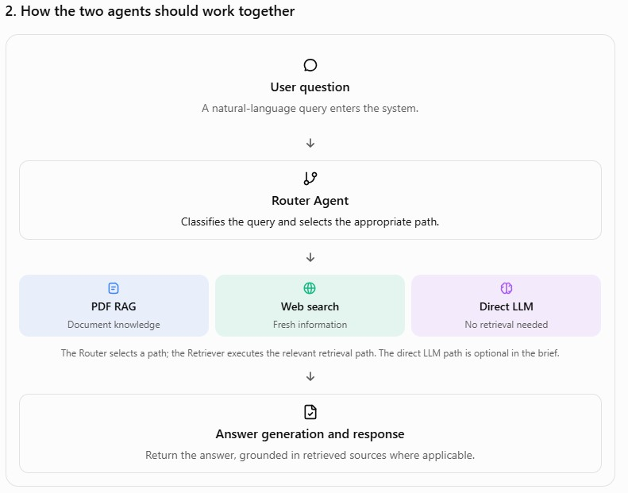
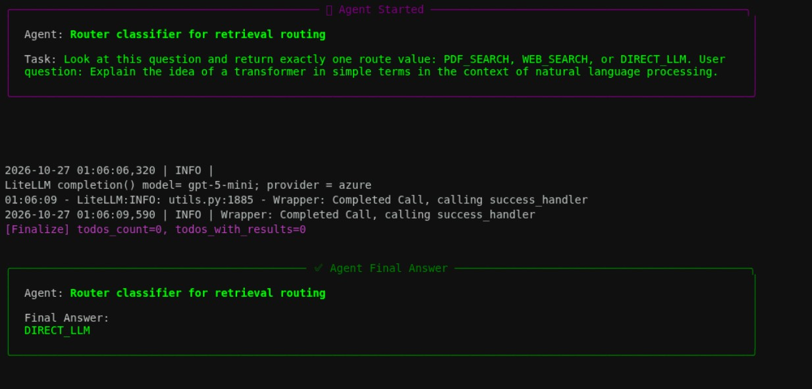
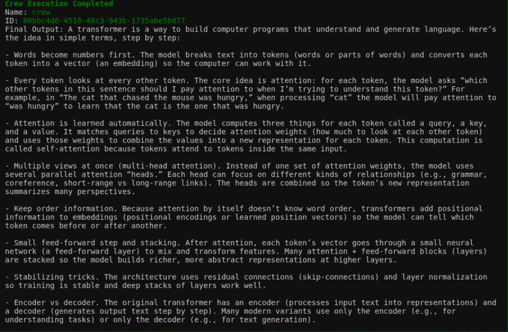
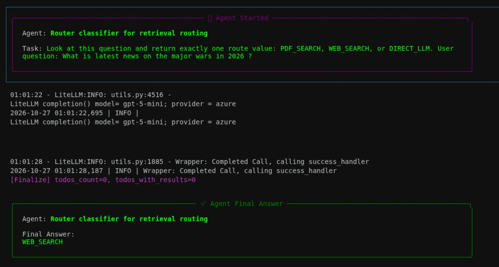
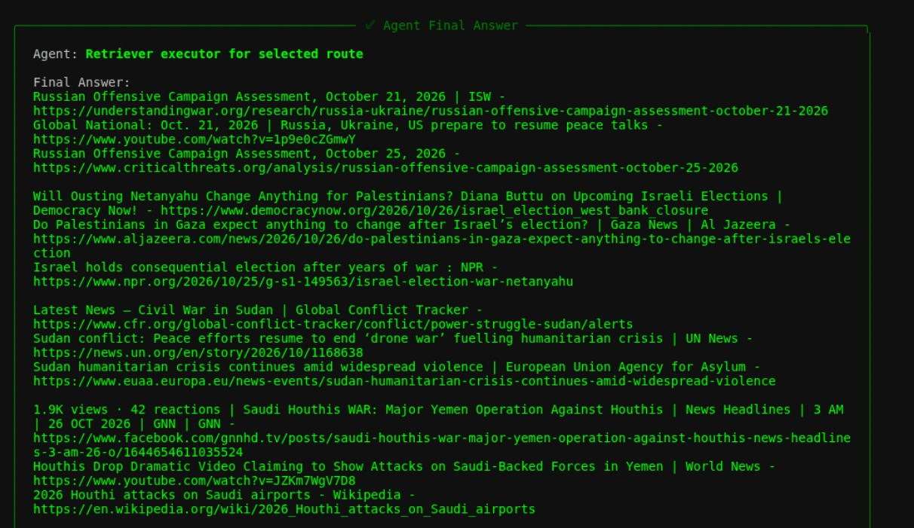
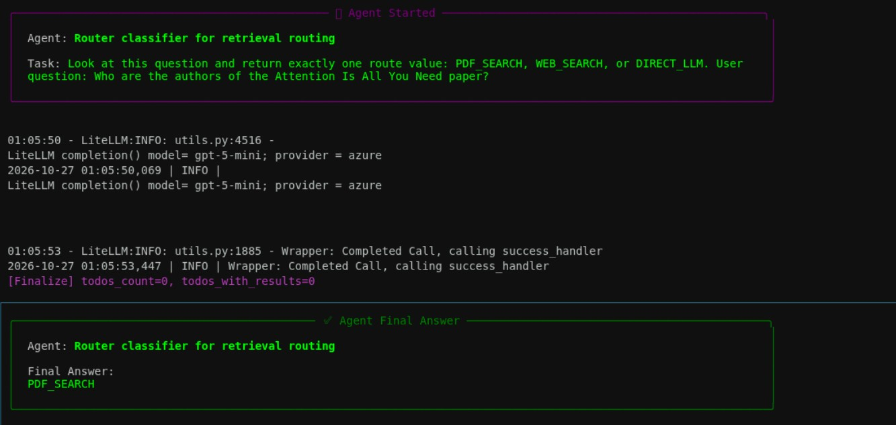
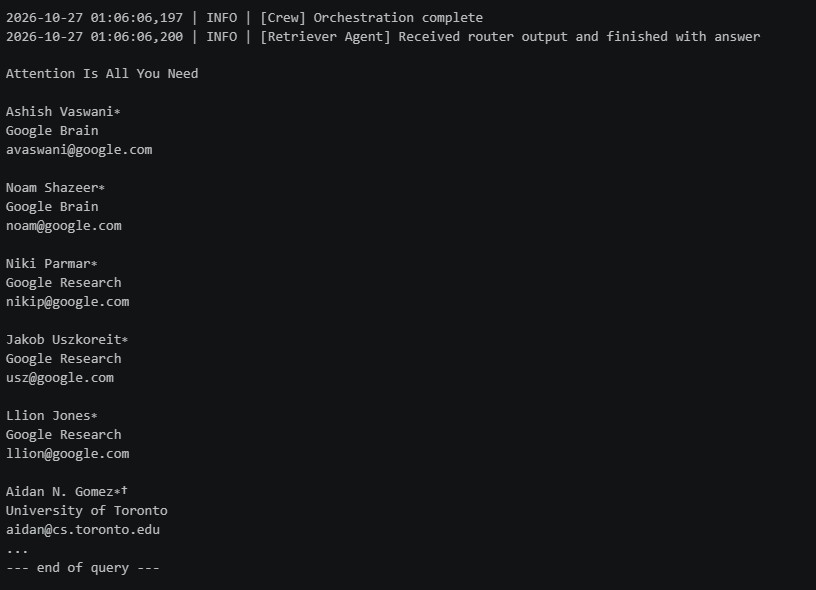
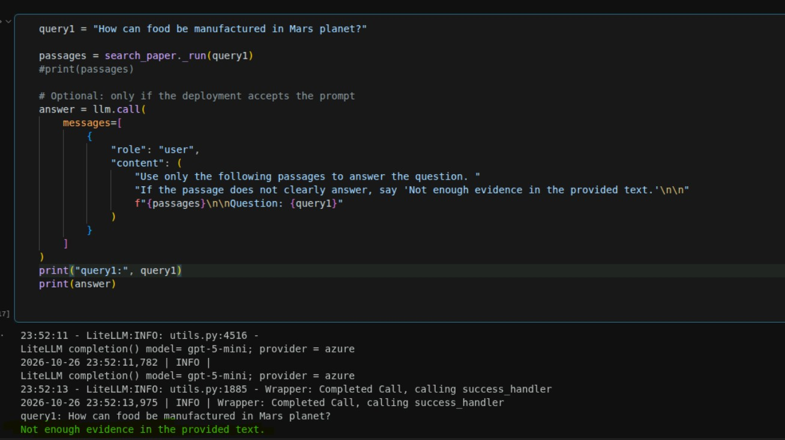

# Multi-Agent Router-Retriever for Web and PDF-Grounded Answers

## 1. Project Overview

This project demonstrates an agentic multi-tool retrieval system that routes user queries to the most appropriate information source before generating a final response. The system is designed to handle a mix of general reasoning, current web information, and local document-grounded retrieval.

- LLM_DIRECT: direct answer generation when the query can be answered from the model’s internal knowledge or a simple contextual prompt
- WEB_SEARCH: retrieval of current or public information from the web when the answer depends on real-time or external content
- PDF_SEARCH: retrieval from domain-specific knowledge embedded in PDF documents or curated local knowledge bases

The objective of this project is to design a robust routing architecture that improves answer quality, reduces hallucinations, and ensures the response is grounded in the most relevant and reliable source available.

This repository contains the implementation and demonstration notebook for a router-retriever multi-agent workflow, with emphasis on:
- Intent classification
- Tool routing
- Retrieval from external web sources
- Retrieval from local PDF content
- Final response synthesis using an LLM

---

## 2. Problem Statement

In many real-world enterprise and research scenarios, user questions do not fit into a single source of truth. Some questions require:
- a direct answer from general reasoning
- current information from the web
- structured domain knowledge stored in PDFs or internal documents

A naive single-pipeline system often fails because it either:
- answers from stale or generic knowledge
- retrieves irrelevant information
- overuses web search when the answer exists in local documents
- hallucinates when required information is missing from the chosen source

This project addresses that challenge by building a multi-agent routing system that decides the correct mode of operation for each user query and then synthesizes the final answer using the best source available.

---

## 3. Project Goal

The main goal of this project is to build a smart agentic workflow that:

1. Understands the user’s intent
2. Routes the question to the correct retrieval mode:
   - LLM_DIRECT
   - WEB_SEARCH
   - PDF_SEARCH
3. Collects the relevant evidence
4. Combines the findings into a grounded answer
5. Returns a clear and explainable final result

---

## 4. Solution Approach

The system is implemented as a multi-agent architecture where a routing layer determines which tool or knowledge source should be used. The design works as follows:

- A user submits a query
- The router evaluates whether the question is:
  - answerable directly by the LLM
  - better answered using live web information
  - better answered using content from a PDF or internal knowledge source
- The chosen tool executes retrieval or search
- The retrieved information is passed back into the reasoning process
- The final answer is generated with context and source awareness

This approach improves answer quality by selecting the most relevant source instead of forcing a single retrieval method for all queries.

---

## 5. Architecture

The architecture below demonstrates the multi-agent orchestration and routing logic used in this project.



### Core Components

- User Query: The incoming question from the user
- Router Agent: Decides the best execution path
- LLM_DIRECT: Direct LLM reasoning path
- Web Search Tool: For public and time-sensitive information
- PDF Search Tool: For local document retrieval and knowledge grounding
- Retrieval Layer: Pulls relevant context from the selected source
- Final Response Generator: Synthesizes the answer with grounded evidence

### Example Routing Logic

- If the question is general and does not require recent information:
  - route to LLM_DIRECT
- If the query requires update-to-date news, facts, or current events:
  - route to WEB_SEARCH
- If the query depends on documentation, policy, PDF reports, or specialist content:
  - route to PDF_SEARCH

---

## 6. Project Structure

```text
Project_rag_websearcg_mag/
├── router-retriever-multi_agent.ipynb
├── mag_orchestration_router_retriever.jpg
├── 1763366029_course_end_project_problem_statement.pdf
└── README.md
```

## 7. Workflow and Execution Flow

The workflow follows a modular agentic pattern:

1. Query enters the system
2. Router decides the source path
3. Tool selection occurs based on query type
4. Relevant documents or search results are retrieved
5. The LLM reasons over the retrieved context
6. Final answer is formatted and returned to the user

This pattern allows the system to handle mixed information needs more intelligently than a single-system retrieval chain.

---

## 8. Tools and Technologies Used

This project uses a modern agentic AI stack including:
- Python
- Jupyter Notebook
- LLM orchestration framework
- Web search integration
- PDF/document retrieval support
- Retrieval-augmented generation (RAG) concepts
- Multi-agent reasoning pipeline

The implementation demonstrates how agentic tools can be composed to create a modular and explainable information retrieval system.

---

## 9. Use Cases

This architecture is useful for:

- Customer support assistants
- Research and knowledge assistants
- Internal document Q&A systems
- Public information retrieval agents
- Domain-aware enterprise workflows
- RAG-based systems requiring tool routing

It is especially effective when a system must answer queries from a mix of:
- general language model knowledge
- real-time external knowledge
- trusted local documentation

---

## 10. Example Query Scenarios

### Example 1: Direct Answer
Query: "What is the difference between RAG and fine-tuning?"

Expected route:
- LLM_DIRECT

### Example 2: Web Search
Query: "What is the latest AI regulation announcement from the government this week?"

Expected route:
- WEB_SEARCH

### Example 3: PDF Search
Query: "According to the project PDF, what are the key requirements for the end-to-end solution?"

Expected route:
- PDF_SEARCH

---

## 11. Agent Task Screenshots and Examples

The screenshots below show representative query/response pairs for each routing mode. Each pair captures the user input and the system’s decision path or result.

### 11.1 Query Routed to LLM_DIRECT

<p align="center">
  
  
</p>

Description:
- The first image shows the router correctly classifying a general question for direct LLM reasoning.
- The second image shows the final answer generated without needing external retrieval.

---

### 11.2 Query Routed to WEB_SEARCH

<p align="center">
  
  
</p>

Description:
- The first image shows the agent invoking the web search tool for a current-events question.
- The second image shows the grounded result returned from the live web search workflow.

---

### 11.3 Query Routed to PDF_SEARCH

<p align="center">
  
  
  
</p>

Description:
- The first image demonstrates a document-grounded query routed to the PDF search path.
- The second image shows the correct answer retrieved from the PDF and grounded in the document evidence.
- The third image illustrates the router’s evidence-checking behavior for a non-relevant or unsupported query, helping prevent hallucinated or unsupported answers.

---

## 12. Expected Outcome

The expected result of this project is a working multi-agent routing design that:
- improves answer relevance
- minimizes unsupported or hallucinated responses
- handles multiple information sources intelligently
- provides a clear architecture for future expansion into production-grade agentic systems

This project is a practical demonstration of how a retrieval system can become more reliable by routing based on the type of question asked.

---

## 13. Challenges Faced

-For bigger pdf documents , the chunking strategy fails as PDFSearchTool does not publicly expose any custom chunker size and tries to load the entire document at once causing RateLimitError. Hence enforced a manually crafter chunker to split the pdf first and add it iteratively into the vector store .
- Many a times, the prompt needed refinement to avoid LLM timing out and returning with failed response , requiring clear and concise instructions for context aware responses from LLM. 
- Latency for certain queries are in minutes for multi step reasoning tasks implying that agentic AI is not suited for latency sensitive real time applications.

---

## 14. Summary

This project showcases a multi-agent system for routing user queries to the correct knowledge source using an agentic design pattern. By combining direct LLM reasoning with web- and PDF-grounded retrieval, it demonstrates a practical and scalable approach to building answer engines that can reason across multiple information sources.

It is a strong example of how agentic AI systems can be designed for practical business and research use cases where information comes from different modalities and sources.


